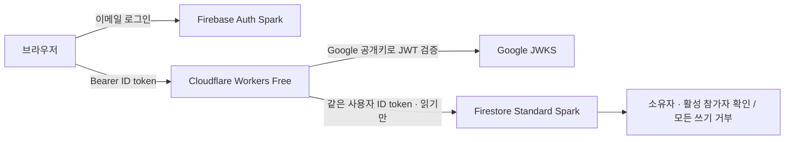

# 무료 실행 구조와 제약

검증 기준일: 2026-10-09. 선택: Firebase Auth 이메일/비밀번호 + Firestore
**Standard / (default) / Spark** + Cloudflare Workers Free와 Static Assets.
계정 연결, 요금제 변경, 실제 데이터 이전, 배포는 이 PR에서 실행하지 않는다.

## 무료 조건

| 서비스 | 무료 조건과 제한 | 선택의 의미 |
| --- | --- | --- |
| Firebase Auth | 이메일/비밀번호 사용. SMS는 Blaze 필요. Identity Platform으로 업그레이드된 Spark 프로젝트는 일반 공급자 3,000 DAU 제한 | SMS, 이메일 링크 로그인, 유료 확장은 사용하지 않는다 |
| Firestore | 프로젝트당 무료 DB 하나; 1 GiB 저장, 일 50,000 읽기 / 20,000 쓰기 / 20,000 삭제, 월 10 GiB 송신 | 기본 DB만 사용. Rules의 get(), 빈 쿼리 및 재시도도 읽기 비용을 고려 |
| Workers Free | 일 100,000 요청, HTTP 요청당 10 ms CPU; 네트워크 대기 시간은 CPU 시간이 아님 | 네이티브 Web Crypto/JWT 검증, 작은 응답과 제한된 페이지 사용 |
| Static Assets | 정적 파일 요청 무료·무제한. /api/*만 Worker 우선 | 별도 Pages, 도메인 구매, 상시 VM 필요 없음 |
| Cloud Functions | 배포에 Blaze 필요 | 사용하지 않음 |

Firestore 일 quota는 태평양 시간 자정 무렵, Workers는 UTC 자정에 리셋한다.
Spark와 Workers Free를 유지하면 무료 범위에서 예상 청구액은 0원이다.
무제한 운영을 뜻하지 않는다. 한도 초과 시 서비스 오류/중단이 발생하며
자동 유료 전환을 구성하지 않는다. 유료 플랜으로 바꾸면 예산 알림만으로
요금이 강제 차단되지 않는다. 무료 도메인 workers.dev를 사용한다.
현재 공식 소스 기준의 한도이며 실제 콘솔과 최신 문서를 배포 전에 재확인한다.

학생 300명이 하루 2번 시장(21기업 + 3뉴스)을 조회하면 문서 읽기 약 14,400회,
여기에 참가자 확인 및 Rules 종속 읽기, 자산 조회가 더해진다.
학생 1,000명이 5번 같은 화면을 조회하면 약 120,000회로 무료 읽기 한도를 넘는다.
초 단위 polling, 실시간 전체 순위 listener, 무제한 페이지 순회는 사용하지 않는다.
현재 시장은 최대 100개, 뉴스 최신 30개를 한 페이지로 반환한다.
참가자 인증 자체가 quota 보호를 완전히 보장하지는 않으므로 운영자 사용량 확인이 필요하다.

## 인증과 권한 경계

1. 비밀번호는 Firebase SDK로 Firebase에 직접 전달한다. Workers에는 전달하지 않는다.
2. 브라우저는 Firebase 세션 저장소에 로그인 상태를 보관한다. 같은 탭에서 새로고침해도 유지되며, 로그인 복원 완료 후 데이터를 조회한다.
   매 요청에서 SDK getIdToken()을 호출해 필요한 경우 만료 토큰을 갱신한다.
3. Workers의 src/auth.js는 jose 라이브러리로 RS256 서명, 고정 Google JWKS,
   issuer, audience, exp, iat, auth_time 및 비어 있지 않은 128자 이하 sub를 확인한다.
   alg=none, HS256, 타 프로젝트 토큰, unsigned emulator 토큰을 받지 않는다.
   공개키는 jose의 캐시와 unknown-kid cooldown을 사용한다.
4. 사용자 경로는 검증된 sub만 사용한다. URL/body의 uid, role, cash는 신뢰하지 않는다.
   users/{uid}.active가 true인 참가자만 행사 데이터에 접근한다.
5. Firestore REST에 동일 ID token을 전달한다. Firestore Security Rules가 다시
   소유자와 참가자 상태를 검사한다. 사용자가 Firestore를 직접 호출해도
   다른 학생 자산 읽기, 자산 쓰기, 역할 승격은 허용되지 않는다.
6. Firestore REST 클라이언트에는 get/list만 있으며 주문은 인증 후 항상 501을 반환한다.
   환경변수로 거래를 켤 수 없다. 요청 body를 읽거나 주문 문서를 생성하지 않는다.

로그아웃은 SDK의 로컬 세션을 종료한다. 이미 탈취된 ID token을 즉시 폐기하는
Admin revocation 검사는 구현하지 않았다. 최대 약 1시간의 토큰 수명 동안 유효할 수 있다.
즉시 행사 접근 차단이 필요하면 운영자가 users/{uid}.active=false로 설정한다.
Rules도 이 상태를 확인한다. 브라우저는 탭 세션에만 로그인을 저장하며 XSS 방지를 위해
표시 문자열 escaping을 유지하고 토큰/응답 오류 내용을 로그에 남기지 않는다.

## 서버 Firestore 접근과 비밀키

현재 읽기 서버는 사용자 ID token 방식이므로 **서비스 계정 키가 필요 없다**.
Firebase web apiKey, projectId, authDomain은 공개 설정으로 /api/config에 노출한다.
web apiKey를 관리자 자격 증명처럼 쓰지 않으며 데이터 권한은 Rules로 결정한다.
실제 운영 설정/학생 데이터는 PR에 넣지 않는다.

향후 신뢰된 자산 변경 서버는 사용자 ID token으로 쓰면 안 된다.
서비스 계정 OAuth 2.0 방식은 IAM을 적용하고 **Security Rules를 우회**하므로,
서버가 참가자/행사/권한/자산 불변식을 직접 검증해야 한다.
구현 시 순서:

- 전용 서비스 계정 생성. 읽기 서비스와 쓰기 서비스 분리. Owner/Editor 금지.
  초기에는 지정 프로젝트의 roles/datastore.user 수준으로 한정하고,
  가능하면 필요한 DB 권한만 포함하는 custom role을 검토한다.
  IAM은 학생별 문서 소유권 검증을 대신하지 않는다.
- 외부 Cloudflare 실행 환경에서는 Firebase Admin SDK ADC가 자동 제공되지 않는다.
  Workers에는 Admin SDK 전체보다 REST + Web Crypto/jose 방식이 적합하다.
- 사용자 승인 후 발급한 키의 client_email과 PKCS#8 private_key를
  wrangler secret put FIRESTORE_CLIENT_EMAIL 및
  wrangler secret put FIRESTORE_PRIVATE_KEY로 업로드한다.
  wrangler.jsonc의 vars, public/, Actions 로그, PR body에 키를 넣지 않는다.
  로컬 키는 Git 밖에 보관하거나 무시된 .dev.vars만 사용한다.
- 서버에서 RS256 서비스 계정 assertion을 서명:
  iss=client_email, scope=https://www.googleapis.com/auth/datastore,
  aud=https://oauth2.googleapis.com/token, iat=현재, exp<=현재+3600.
  grant_type=urn:ietf:params:oauth:grant-type:jwt-bearer로 OAuth endpoint에 교환한다.
  반환 access_token을 expiry보다 일찍 만료시키며 isolate 메모리에 캐시한다.
  키와 access_token은 클라이언트 응답에 포함하지 않는다.
- 키 교체: 새 키/secret 등록 → 검증 → 구 키 폐기. 유출 시 즉시 폐기하고 접근 조사.
  장기적으로 Workload Identity Federation은 Cloudflare에서 신뢰할 수 있는
  외부 identity 발급이 확보될 때 검토한다. 자동 ADC/WIF가 있다고 가정하지 않는다.

이는 향후 쓰기 경로의 설계이며 현재 키 발급·OAuth 교환·거래 쓰기는 구현/활성화하지 않는다.
Spark에서 REST 호출이 외부 서버라는 이유로 Blaze를 요구하지는 않는다.
서비스 계정 IAM 사용도 quota를 늘리거나 무료 한도를 없애지 않는다.

## 데이터 모델

| 경로 | 필드 | 사용자 권한 |
| --- | --- | --- |
| users/{authUid} | displayName, role, active | 자신의 문서 get만 |
| portfolios/{authUid} | cash, holdings[], version | 활성 참가자 자신의 문서 get만 |
| assignments/{authUid} | companyIds[] (최대 5) | 활성 참가자 자신의 문서 get만 |
| companies/{companyId} | ticker, name, category, description, referencePrice, issuedShares, companyCash, dailyRevenue, status | 활성 참가자 get / 최대 100 list |
| news/{newsId} | title, content, companyId, companyName, publishedAt (timestamp) | 활성 참가자 get / 최대 30 list |
| orders, fills, 운영 컬렉션 및 모든 subcollection | 향후 내부 데이터 | 거부 |

portfolios의 holdings는 최대 100개로 한 문서에 함께 저장한다.
각 원소: companyId, ticker, name, quantity, referencePrice.
현재 referencePrice는 자산 생성 시 저장한 참고값이며 실시간 시세가 아니다.
단일 문서로 cash와 holdings를 읽어 서로 다른 시점의 자산을 섞지 않는다.
cash/quantity/price는 부동소수점이 아닌 안전한 정수 사용; 0 이상, 최대값 명시.
버전은 증가하는 정수. 모든 문서는 운영자만 준비하고 초기 지급 금액은 행사의 확정 규칙으로 정한다.
companies/news에는 모든 참가자에게 보여도 되는 정보만 저장한다.
Rules는 IAM 관리자 입력 스키마를 검증하지 않으므로 운영 도구가 필드/길이/타입을 검증해야 한다.

## 향후 원자적 거래 설계 (실행하지 않음)

규칙 확정 후 별도 리뷰에서 구현한다. 실제 금전/결제 기능이 아니다.
1. 검증된 UID, 활성 참가 상태, 행사 시간, side, 정수 quantity와 허용된 companyId,
   요청 길이 및 idempotency key를 검증한다. body의 가격/잔고/UID/역할은 사용하지 않는다.
2. 서비스 계정 OAuth로 Firestore documents:beginTransaction(readWrite) 호출.
3. 동일 transaction으로 users/{uid}, portfolios/{uid}, 시장 가격·정책 버전,
   필요한 상대방 자산/기업 재고 및 UID 범위의 idempotency 문서를 모두 읽는다.
   상대방이 있는 체결 방식이면 모든 참가자의 변경을 같은 트랜잭션에 포함한다.
4. 이미 같은 key가 있으면 요청의 정규화 fingerprint를 비교하여
   동일 요청에는 저장된 결과 반환, 다른 요청에는 409. 동시에 key를 새로 만들려면
   currentDocument.exists=false를 적용한다.
5. 서버 가격/수수료/정책만으로 계산. cash와 보유량의 음수, 초과 판매,
   주식/현금 보존, 정수 overflow, 정지 기업, 정책 변경을 검증.
   규칙 미확정 시 어떤 체결도 수행하지 않는다.
6. documents:commit에 transaction ID와 portfolios의 cash/holdings/version,
   체결 원장, 주문 결과, idempotency 기록 및 재고/상대방 변경을 모두 포함.
   별도 순차 update, D1과 Firestore 이중 쓰기는 금지한다.
7. ABORTED면 모든 읽기·계산을 새 transaction으로 재실행 (최대 3회, jitter backoff).
   응답이 유실된 commit은 성공 여부가 불명확하므로 같은 key로 결과부터 조회한다.
   quota 초과는 즉시 429/503, 무한 재시도 금지. 실패 transaction은 rollback.
8. 동시 매수/매도, 중복 요청, key 재사용, overflow, 부분 실패, commit 응답 유실,
   정책 버전 변경을 emulator와 실제 무료 테스트 DB에서 검증한 후에만 활성화.

현재 테스트는 주문이 어떤 입력에서도 자산을 변경하지 않음을 검증한다.
위 알고리즘의 원자성/체결 정확도를 구현했다고 주장하지 않는다.

## 공식 근거

- [Firebase 요금제](https://firebase.google.com/docs/projects/billing/firebase-pricing-plans)
- [Functions의 Blaze 배포 요건](https://firebase.google.com/docs/functions/get-started)
- [Firestore 무료 한도](https://firebase.google.com/docs/firestore/quotas)
- [Auth 한도](https://firebase.google.com/docs/auth/limits)
- [ID token 검증](https://firebase.google.com/docs/auth/admin/verify-id-tokens)
- [REST 인증과 IAM/Rules 구분](https://firebase.google.com/docs/firestore/use-rest-api)
- [Firestore 트랜잭션](https://firebase.google.com/docs/firestore/manage-data/transactions)
- [서비스 계정 OAuth](https://developers.google.com/identity/protocols/oauth2/service-account)
- [Workers Free 한도](https://developers.cloudflare.com/workers/platform/limits/)
- [Workers 요금](https://developers.cloudflare.com/workers/platform/pricing/)
- [정적 파일 무료 제공](https://developers.cloudflare.com/workers/static-assets/billing-and-limitations/)
